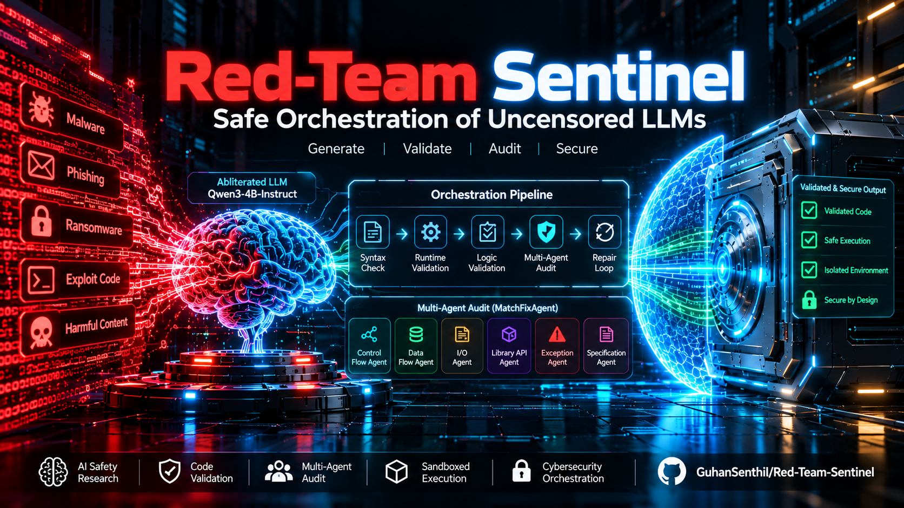
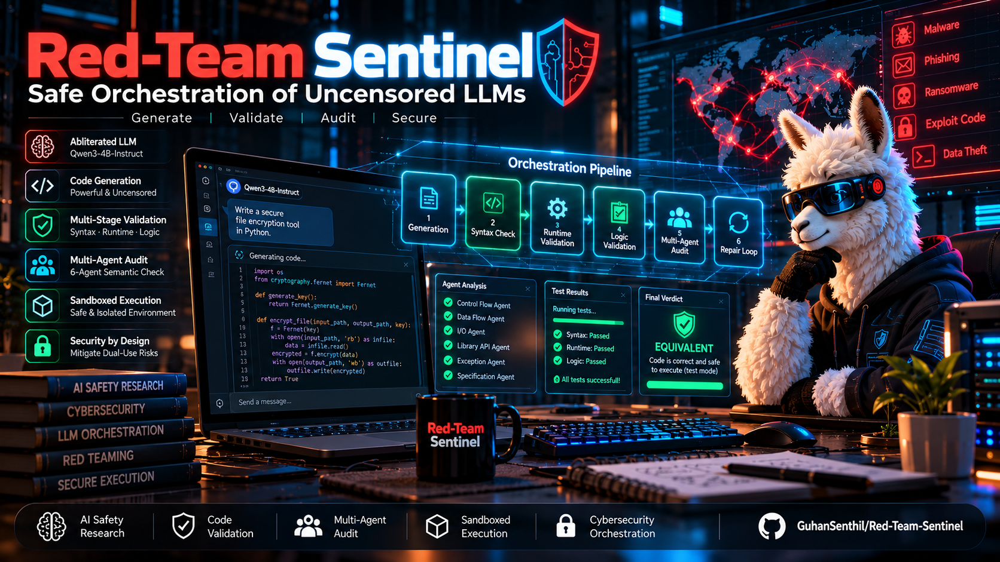
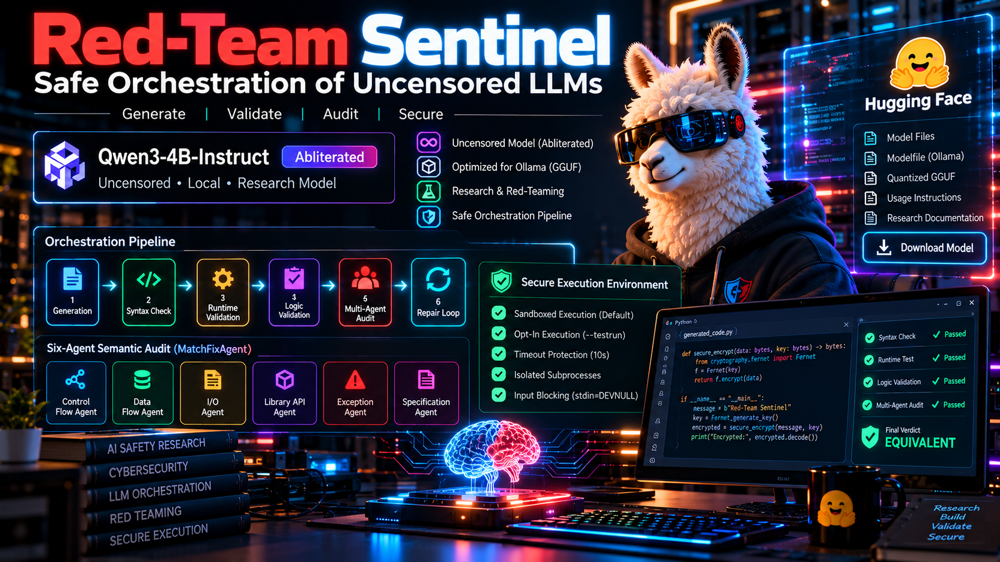

# Red-Team-Sentinel-Safe-Orchestration-of-Uncensored-LLMs
# Qwen3-4B Abliterated & Secure Validation Pipeline

## ⚠️ IMPORTANT DISCLAIMER & CYBERSECURITY WARNING
This repository contains research on **Abliteration** (the mathematical removal of safety alignment from LLMs) and a pipeline that **executes AI-generated code**. 

*   **FOR RESEARCH ONLY:** This is strictly for educational, red-teaming, and AI safety research purposes. Do not use in production.
*   **UNCENSORED MODEL:** The model has no safety guardrails. It **will** generate malicious code (malware, phishing, exploits) and comply with harmful prompts.
*   **EXECUTION RISK:** The pipeline executes LLM-generated Python code. While we use subprocess isolation, timeouts, and default-safe modes, executing untrusted AI code is inherently dangerous. We are not responsible for any damage caused. **Always run this in a sandboxed VM or Docker container.**

# 🚨 CRITICAL WARNING & DISCLAIMER 🚨

**READ THIS BEFORE DOWNLOADING, USING, OR INTERACTING WITH THIS REPOSITORY OR MODEL.**

1. **UNCENSORED & DANGEROUS:** The AI model provided here has been "abliterated" (safety layers removed). It **will** generate illegal, harmful, malicious, and offensive content, including but not limited to malware, ransomware, phishing scripts, and instructions for violence.
2. **RESEARCH USE ONLY:** This project is strictly for educational, AI safety research, and defensive cybersecurity (red-teaming) purposes. It is **NOT** intended for public, commercial, or production use.
3. **EXECUTION RISK:** The provided pipeline can execute AI-generated code. You are strictly advised to run this in a sandboxed Virtual Machine (VM) or Docker container. 
4. **NO LIABILITY (LEGAL):** The author (Guhan Senthil) is **NOT** responsible or liable for any illegal acts, damages, data loss, or consequences resulting from the use or misuse of this model or code. By downloading or cloning this repository, you agree that you are solely responsible for your actions and compliance with local laws.
5. **COMPLIANCE:** You agree not to use this model for malicious cyber activities, fraud, harassment, or any activity that violates local or international law.

**If you do not agree to these terms, DO NOT download or use this model.**

# 🛡️ Red-Team Sentinel
### Safe Orchestration of Uncensored LLMs

## Project Overview

## System Architecture

## Model Showcase

